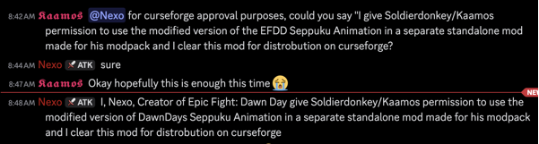

# Seppuku

A small Forge 1.20.1 mod for the Winterheart modpack. It plays a seppuku animation
on a player for the bad ending. The animation is visible in first person when
First Person Model is installed.

Requires [PlayerAnimator](https://github.com/KosmX/minecraftPlayerAnimator)
(`playeranimator` 1.0.2-rc1+1.20 or newer) on both the client and the server.

## Credits

The seppuku animation is by **Nexo** and **sidtheplayer**, from
[**Epic Fight: Dawn Day**](https://www.curseforge.com/minecraft/mc-mods/epic-fight-dawn-day).
It is converted and used with Nexo's permission, including distribution on
CurseForge (see [Permission](#permission) below). Dawn Day is All Rights Reserved,
and the animation remains the property of its original authors.

## How this differs from Epic Fight: Dawn Day

- **No Epic Fight needed.** Dawn Day is an Epic Fight add-on. Seppuku runs on
  PlayerAnimator and the vanilla player model.
- **One animation only.** It contains just the seppuku animation, converted from
  Epic Fight's skeleton format to the vanilla player model by a custom converter.
  The converter aims the arms, matches the sword grip, and trims the animation to
  the kneeling stab.
- **Built for scripted use.** It adds a command and a server-side API so modpacks
  and KubeJS can trigger the animation. The animation is synced to every player
  who can see it.
- **None of Dawn Day's other content.** It has no weapons, movesets, mob death
  animations or loot.

## Hook

Commands (permission level 2, so they work from KubeJS `server.runCommandSilent`):

```
/seppuku play <targets> [animation]   # default animation: seppuku:seppuku
/seppuku stop <targets>
```

Java/KubeJS API (server side):

```js
const SeppukuApi = Java.loadClass('io.github.soldierdonkey2.seppuku.SeppukuApi')
SeppukuApi.play(player)
SeppukuApi.stop(player)
```

The animation plays for 59 ticks (about 3 s) on the player and everyone who can
see them, then holds the final kneeling pose until `stop` is sent or the player
respawns. See [examples/kubejs_bad_ending.js](examples/kubejs_bad_ending.js) for
the day 50 / low sanity trigger.

## Building

```
JAVA_HOME=/Library/Java/JavaVirtualMachines/temurin-21.jdk/Contents/Home ./gradlew build
```

The jar ends up in `build/libs/seppuku-<version>.jar`, and the build also copies it
into the instance's `mods/` folder (replacing older `seppuku-*.jar`). Gradle 8.8
cannot run on Java 22+, so point `JAVA_HOME` at Java 17 or 21.

## Publishing to CurseForge

```
CURSEFORGE_TOKEN=your-token ./gradlew publishCurseForge
```

Set `curseforge_project_id` in `gradle.properties` first and bump `mod_version`.
**Never commit the API token.** Release notes come from `CHANGELOG.md`.

## Regenerating the animation

`src/main/resources/assets/seppuku/player_animation/seppuku.json` is generated from
the Epic Fight animation by `tools/convert_epicfight.py` (needs Python 3 and numpy):

```
python3 tools/convert_epicfight.py path/to/sepukku.json \
    src/main/resources/assets/seppuku/player_animation/seppuku.json --end 2.9
```

Options:
- `--start` / `--end`: the section of the source animation to use, in seconds. The
  source is 4.68 s long. The kneeling stab ends around 2.9 s, and after that the
  player stands back up.
- `--keep-horizontal`: keep the hips' forward travel. This is off by default so
  the body stays under the first-person camera.

The vanilla player model has no elbows or knees. The converter therefore aims
each straight arm at the Epic Fight hand and moves the held item so the sword
grip matches the original exactly. Kneeling legs come out straight along the
thighs.

## Permission

Nexo, the creator of Epic Fight: Dawn Day, gave permission for this mod and for
its distribution on CurseForge:

> I, Nexo, Creator of Epic Fight: Dawn Day give Soldierdonkey/Kaamos permission to
> use the modified version of DawnDays Seppuku Animation in a separate standalone
> mod made for his modpack and I clear this mod for distrobution on curseforge


